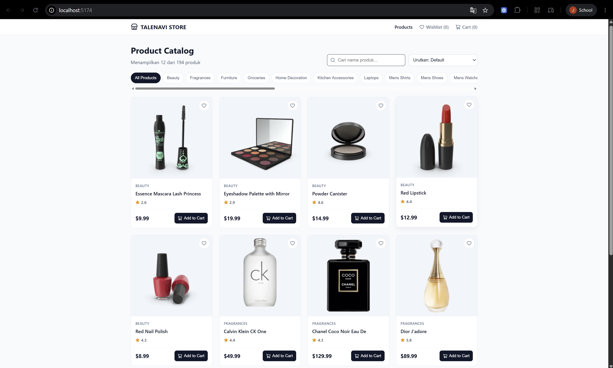
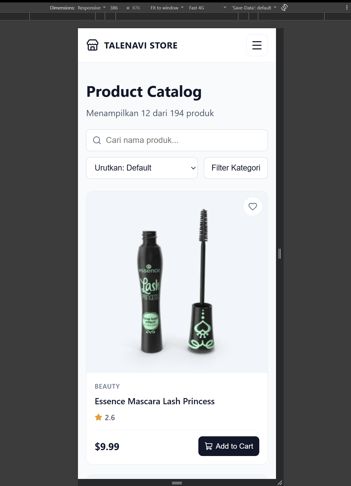

# TALENAVI STORE — Product Catalog

Aplikasi web katalog produk e-commerce responsif yang dibangun menggunakan **React.js** dan **Vite** untuk **Frontend Developer Technical Test — PT Dynamic Talenta Navigator (Talenavi)**. Aplikasi ini mengambil data secara dinamis dari DummyJSON REST API serta dilengkapi manajemen keranjang belanja dan wishlist secara persisten di sisi klien.

🔗 **Live Demo:** [https://talenavi-product-catalog.vercel.app](https://talenavi-product-catalog.vercel.app)

---

## Fitur Utama

- **Katalog Produk & Pagination:** Menampilkan 12 produk per halaman menggunakan parameter `limit` dan `skip` dengan navigasi nomor halaman dinamis.
- **Pencarian Real-Time (Debounced):** Pencarian produk berdasarkan kata kunci yang dioptimalkan dengan *custom hook* `useDebounce` (400 ms) untuk mencegah pemanggilan API berulang saat mengetik.
- **Filter Kategori & Sorting:** Penyaringan daftar produk berdasarkan kategori dari API serta pengurutan (*sorting*) berdasarkan **Harga** (terendah/tertinggi) dan **Rating**.
- **Detail Produk (`/products/:id`):** Menampilkan galeri gambar interaktif, merek, rating, ketersediaan stok, diskon, pengaturan jumlah pembelian, serta daftar ulasan pelanggan (**Customer Reviews**).
- **Wishlist (`/wishlist`):** Menyimpan dan mengelola daftar produk favorit pengguna.
- **Keranjang Belanja (`/cart`):** Mengubah jumlah item (`+`/`-`) dengan **validasi batas maksimal stok** dari API, menghapus produk, menghitung subtotal dan total harga otomatis, serta simulasi *checkout*.
- **Penyimpanan Persisten:** Data keranjang dan wishlist tersimpan otomatis ke `localStorage` sehingga tetap aman meskipun halaman di-*refresh*.
- **Penanganan State & Responsive UI:** Dilengkapi indikator *loading*, pesan data kosong (*empty state*), penanganan *error* dengan tombol **Coba Lagi**, serta tata letak responsif untuk Mobile (1–2 kolom + *hamburger menu*), Tablet (3 kolom), dan Desktop (4 kolom).

---

## Tech Stack

- **Framework:** React.js (Vite)
- **Routing:** React Router DOM v7
- **Icons:** Lucide React
- **State Management:** React Context API + `localStorage`
- **API:** DummyJSON Products API
- **Styling:** Vanilla CSS (Responsive CSS Grid & Flexbox)

---

## Alasan Pemilihan State Management

Aplikasi ini menggunakan **React Context API** yang dikombinasikan dengan **`localStorage`** (`ShopContext`) untuk mengelola *state* **Cart (Keranjang)** dan **Wishlist (Favorit)** karena:

1. **Sesuai dengan Skala & Kompleksitas Aplikasi:** Kebutuhan *global state* berfokus pada sinkronisasi jumlah item di Navbar, halaman katalog, halaman detail produk, wishlist, dan keranjang. React Context API sudah sangat memadai tanpa menambah ukuran *bundle* dari *library* eksternal seperti Redux.
2. **Persistensi Data Sisi Klien:** Karena endpoint `POST/PUT/DELETE` pada DummyJSON hanya bersifat simulasi (tidak tersimpan permanen di server), sinkronisasi otomatis dengan `localStorage` memastikan data belanja dan produk favorit pengguna tetap bertahan setelah halaman di-*refresh*.
3. **Validasi Stok Terpusat:** Seluruh logika penambahan maupun perubahan kuantitas item dikontrol di satu tempat (`ShopContext`), sehingga pembatasan jumlah pembelian agar tidak melebihi stok produk dari API berjalan konsisten di seluruh halaman.

---

## Struktur Folder

text
src/
├── assets/          # Aset statis aplikasi
├── components/      # Komponen UI reusable (Navbar, SearchBar, ProductCard, Pagination)
├── context/         # Global state management untuk Cart & Wishlist (ShopContext)
├── hooks/           # Custom hooks (useDebounce)
├── pages/           # Halaman utama (Home, ProductDetail, Wishlist, Cart)
├── services/        # Layanan integrasi REST API terpisah (productService)
├── App.jsx          # Konfigurasi routing utama
├── index.css        # Styling global dan responsif (Mobile, Tablet, Desktop)
└── main.jsx         # Entry point aplikasi

---

## Cara Menjalankan di Lokal

1. Clone repository ini ke komputer Anda:
   bash
   git clone https://github.com/24k10020-ai/talenavi-product-catalog.git
   cd talenavi-product-catalog
   

2. Install seluruh *dependencies* yang dibutuhkan:
   bash
   npm install

3. Jalankan server pengembangan lokal:
   bash
   npm run dev

4. Buka browser dan akses alamat **`http://localhost:5173/`**.

---

## Tampilan Aplikasi (Desktop & Mobile)

| Tampilan Desktop ($\ge 1280\text{px}$) | Tampilan Mobile ($\ge 360\text{px}$) |
| :---: | :---: |
|  |  |